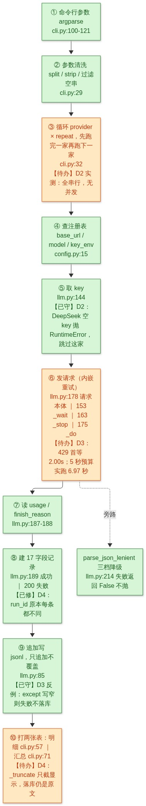

# eval-lab

把一个 prompt 打给多家大模型 API，把**每次调用**（延迟 / token / 成本 / 重试次数 / 原始输出 / 失败原因）记成一行 JSON，再用这份记录做对比、归因和回归。

**它存在的理由**：评测里每一条结论都必须能指到"哪条记录、哪个字段"。没有落库，评测就退化成"看一眼输出凭感觉说好坏"。



---

## 现在能跑的四件事（都已真实跑过，不是设想）

### 1. 不用任何 key 也能跑通链路

```powershell
uv run eval-lab compare --prompt "用一句话解释什么是幻觉" --providers mock
```

mock 是一等的 provider，写在 `config.py` 的注册表里。它的作用是：**换一台机器、断网、额度用完，整条链路（落库/统计/失败处理）照样能验。**

### 2. 同一个 prompt 打多家，并排看延迟和成本

```powershell
uv run eval-lab compare --prompt "用一句话解释什么是幻觉" --providers zhipu,siliconflow,qwen --repeat 3
```

`--repeat 3` 是刻意的：`temperature=0` 也会不一致，**方差是你必须早看见的东西**。

### 3. 把故障打到真实 HTTP 链路上（不是内存里抛假异常）

```powershell
uv run eval-lab faults
```

进程内起一个 OpenAI 兼容的故障服务器（`127.0.0.1:8791`），按 model 名分流：`fault-ok` / `fault-flaky-N` / `fault-429` / `fault-slow` / `fault-500` / `fault-badjson`。七个场景带 7 条自动断言，输出"期望 vs 实际"。

### 4. 跑一遍用例集，用迷你 judge 现场判

```powershell
uv run python scripts\run_dataset_v0.py
```

10 条用例在 `data\dataset_v0.jsonl`，每条都有 `prompt` + `expect` + `judge`。

### 回归

```powershell
uv run pytest -q
```

3 个测试全部不需要 key。

---

## 目录

```
src/eval_lab/
  config.py    provider 注册表（base_url / model / key_env）+ 价格表（占位值）
  llm.py       call_llm / 重试退避 / 落库 / parse_json_lenient
  cli.py       compare、simulate、faults 三个子命令
  faults.py    本地故障服务器 + 七场景探针
  simulate.py  早期版本：内存里抛假异常（保留作对照）
data/dataset_v0.jsonl     10 条用例（prompt + expect + judge）
results/calls.jsonl       所有调用记录，一行一条，只追加
results/d3_faults.json    D3 七场景明细
docs/                     风险自评、核心代码解析、每日记录
scripts/                  自检运行器、风险图渲染
tests/test_llm.py         不需要 key 的冒烟测试
```

---

## 四个设计取舍（这一层最值得讲的部分）

1. **`max_retries=0`**（`llm.py:148`）
   openai SDK 自己会重试 2 次。不关掉，我的 4 次退避实际会打出 12 次请求，而 `attempts` 只记 4。**重试只能有一层，而且必须是自己的那层**，否则可观测性直接失真。

2. **失败也必须落库**（`llm.py:199` 用的是 `except Exception`，不是只捕可重试错误）
   只捕可重试错误的话，400/401 会抛穿、`_log` 不执行，结果就是"数据里只有成功样本，失败率永远为 0"。**分母悄悄变小是评测里最难发现的一种谎言。**

3. **退避取 `max(指数退避, Retry-After)`**（`llm.py:159`）
   服务端说等 2 秒，你只等 1 秒就冲上去，这次尝试必输。实测：持续 429 时首次等待正好 2.00 秒，服务端收到的间隔也是 2.00。

4. **解析失败返回 `False`，不抛异常**（`llm.py:232`）
   "算 0 分还是算 error"是评测语义，不该由工具层替调用方决定。`parse_json_lenient` 只做宽容格式，不补括号、不猜字段。

---

## 已有数据（截至 2026-11-24）

`results/calls.jsonl` 共 **74 条**：zhipu 24 / mock 20 / fault 20 / qwen 5 / siliconflow 5。

| 实验 | 结果 |
|---|---|
| D2 三家并排（各 3 次） | p50：siliconflow 551ms（344–4374）/ zhipu 1519ms（1327–2559）/ qwen 2231ms（1836–2841） |
| D2 对照实验 | 三家都把"幻觉"答成精神科定义；补上"在大语言模型语境下"后立刻答对 → **失败在用例缺语境，不在模型能力** |
| D3 七场景 | **7/7 PASS**；持续 429 等待 2.0→2.41→4.27→8.0 秒；5 秒预算实跑 6.97 秒（**预算判在起跑前，按 1.4 倍预留**） |
| D4 用例集 | **9/10**；唯一 FAIL 是故意保留的基线 `ambiguity-001` |

### 9 环节覆盖自评（诚实版）

**覆盖 2.5 / 9**。完整的是第 7 环生成；部分覆盖第 6 环上下文拼装、第 8 环工具调用、第 12 环成本预算；其余 6 环项目里没有。详见 `docs/D5-9环节风险自评.md`。

---

## 已知不足（自己先说出来）

| 不足 | 影响 | 计划 |
|---|---|---|
| `messages` 没有落库 | 只存了 `prompt`，将来加 system / 模板后说不清"真正送进去的是什么" | 加 `messages_json` 字段 |
| 全串行，无并发 | 100 条 × 4 家要跑很久 | W5 矩阵调度器 |
| dataset 没接进 CLI | 现在靠 `scripts/run_dataset_v0.py` 顶着 | W3 |
| 没有 scorer | 只出延迟/成本，不出分数；迷你 judge 在脚本里，不是正式实现 | W3 |
| 价格表是占位值 | 成本结论暂不可引用 | 写报告前按控制台改 |
| `run_id` 曾按记录生成 | 已修（改成进程级一次），但历史记录无法按批次筛选 | 已记录在 `docs/D4-用例怎么写.md` |

---

## 两条纪律

1. `results/calls.jsonl` **只追加不覆盖**。它是后面所有报告的原始证据。
2. 屏幕上的表格是**采样**（`_truncate` 只显示 46 字）。**任何断言、打分、写报告，只准读 jsonl 的原文，不许读表格或截图。**

---

## 环境（这台机器专用）

- Python 锁 **3.12**（`uv` 的解释器在 `D:\dev\uv-python`）；依赖缓存指向 D 盘。
- Windows + PowerShell，每个新窗口先 `$env:Path="C:\Users\16904\.local\bin;$env:Path"`。
- `huggingface.co` 不通，需要时统一走 `HF_ENDPOINT=https://hf-mirror.com`。
- `.env` 不入库。填 key 用 `Copy-Item .env.example .env`，三家分别是 `ZHIPU_API_KEY` / `SILICONFLOW_API_KEY` / `DASHSCOPE_API_KEY`。
- `docs/course/` 是课程材料（第三方内容，7.7MB），已 gitignore，不随项目入库。
